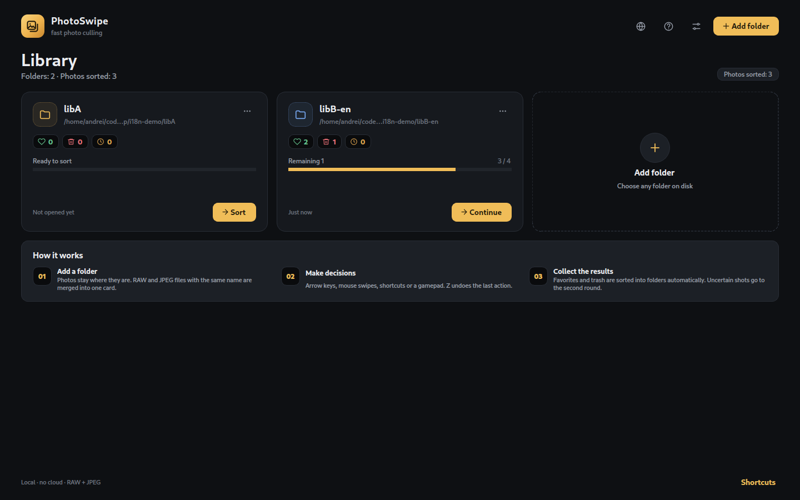
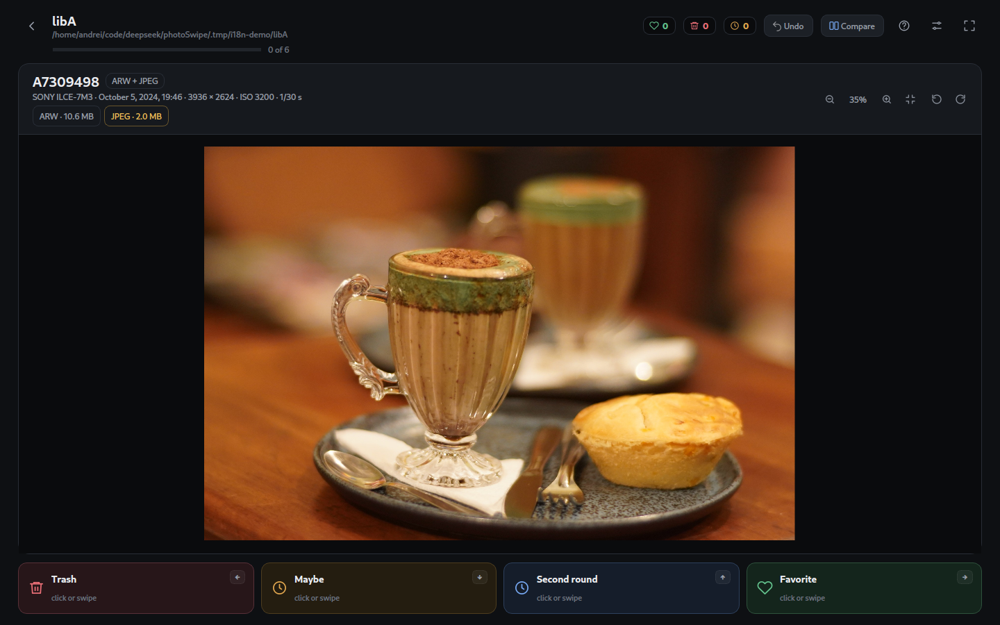
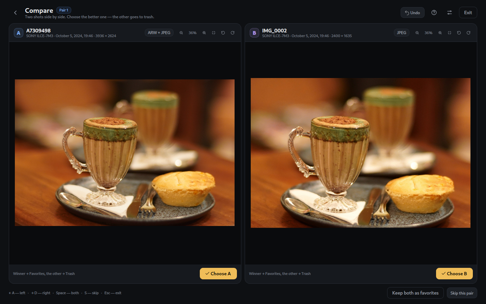
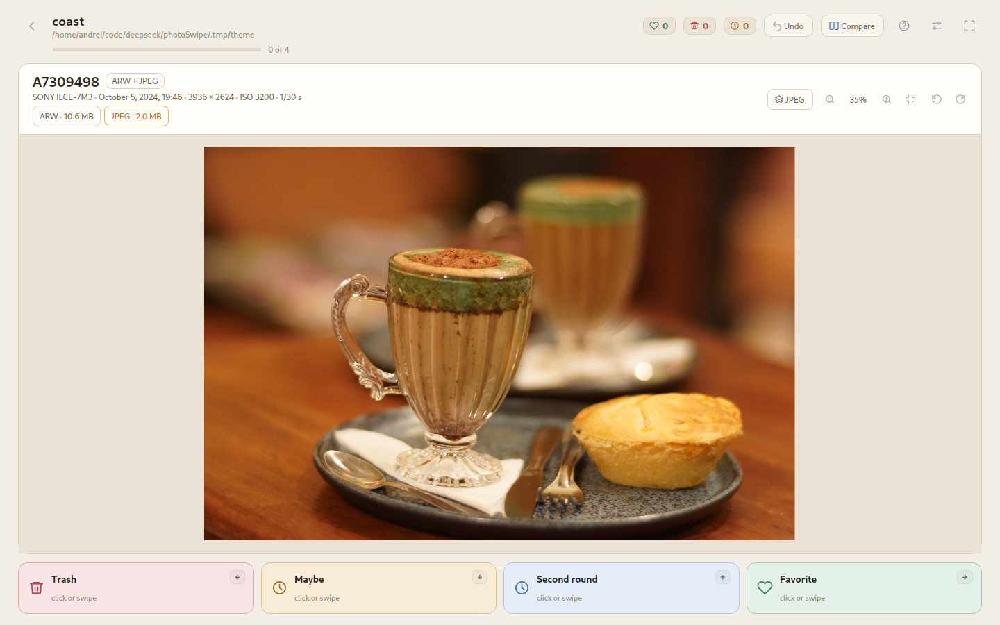
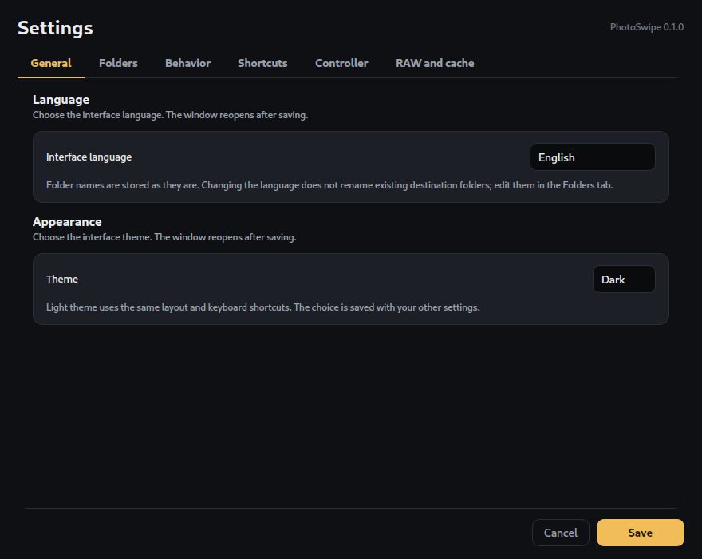

# PhotoSwipe

[**English**](README.md) · [Русский](README.ru.md) · [Português (Brasil)](README.pt.md)

A fast **desktop** photo culler: flip through a folder, keep the best shots, and sort everything else into folders. RAW and JPEG files with the same name are treated as one photo. Everything runs locally — no cloud, no uploads.



<p align="center">
  
  
</p>

## Why Python + PySide6

- The same code runs on **Windows 10/11** and **Linux**. Qt also works on macOS, although Windows/Linux are the primary targets.
- The core (scanning, RAW+JPEG pairing, file moves, undo history) does not import Qt. The UI can be replaced without rewriting the sorting logic.
- PySide6 is the official Qt binding. A path to **Android** exists via `pyside6-android-deploy`; see the Android section below.
- RAW is decoded through **rawpy / LibRaw** (bundled in the wheel), so no separate dcraw or exiftool installation is needed.

## Features

- **Interface languages:** English, Russian, and Portuguese (Brazil). Choose the language in **Settings → General** or with the globe button in the Library header.
- **Dark and light themes:** choose the palette in **Settings → General → Appearance**.
- **Immersive fullscreen:** hide all controls except the exit button while every keyboard and controller shortcut keeps working.
- **Portable Windows mode:** keep settings, sessions, and cache next to the executable on a USB drive.
- Full-window photo review with a dark, distraction-free interface.
- Four decisions: **Favorite**, **Trash**, **Maybe**, and **Second round**.
- Mouse/touch swipes, fully configurable hotkeys, and gamepad input.
- Zoom with the wheel and buttons, drag to pan, rotate 90°, reset the view.
- **Comparison mode:** two photos side by side; the winner goes to Favorites, the other to Trash. You can also keep both or defer the pair.
- RAW + JPEG (and other formats) with the same name are one card. Switch formats for viewing; the decision applies to the whole group.
- Sony ARW/SRF/SR2, Adobe DNG, Canon CR2/CR3, Nikon NEF/NRW, Fujifilm RAF, Olympus ORF, Panasonic RW2, and other LibRaw formats.
- Undo recent actions, including after restarting the app.
- Safe moves that never overwrite: name collisions get a ` (1)`, ` (2)` suffix.
- Configurable destination folders: beside each source folder or in a shared output root.
- Second round: deferred photos stay in place and are shown as a separate queue.
- Sidecar files (`.xmp`, `.aae`, `.pp3`, `.dop`, `.on1`, `.cos`) move with their photo.

## Installation

Requires **Python 3.10+** (tested on 3.12).

### Linux

```bash
sudo apt install python3-venv libxcb-cursor0 libxkbcommon-x11-0  # usually already present
python3 -m venv .venv
source .venv/bin/activate
pip install .
photoswipe
```

If you see `Could not load the Qt platform plugin "xcb"`, install the XCB libraries named in the Qt error and try again.

### Windows

```powershell
py -3.12 -m venv .venv
.venv\Scripts\activate
pip install .
photoswipe
```

### Portable Windows / USB drive

1. Build `PhotoSwipe.exe` on Windows (see the standalone build section) or copy an existing build.
2. Put the executable in its own folder.
3. Create an empty file named `portable.flag` next to `PhotoSwipe.exe`. Alternatively, copy `packaging/portable.bat` next to it and launch that file.
4. Start the app. Settings, sessions, undo history, and preview cache are stored in `PhotoSwipeData` beside the executable.

You can also launch it explicitly with:

```powershell
PhotoSwipe.exe --portable
```

The folder is then self-contained — move it to another PC or USB drive with the whole `PhotoSwipeData` directory. Deleting `PhotoSwipeData` resets app state and cache but does not touch your photos. The `PHOTOSWIPE_DATA_DIR` environment variable still works as a manual override.

After building on Windows, `packaging/make_portable_windows.ps1` creates a ready-to-copy `dist\PhotoSwipePortable` folder with the executable, data marker, and launcher.

### Run from source

```bash
python -m photoswipe
```

For a portable setup:

```bash
PHOTOSWIPE_DATA_DIR=/path/to/photo-swipe-data python -m photoswipe
```

`PHOTOSWIPE_CACHE_DIR` can override the preview cache location separately.

## First run

1. Click **Add folder** and choose a directory with photos. Subfolder scanning can be enabled.
2. PhotoSwipe finds images and pairs RAW+JPEG files by name.
3. Decide with the arrow keys, buttons, swipes, or a gamepad.
4. When the queue ends, click **Second round** if any photos were deferred.

By default, results are stored next to the source folder:

```
My folder/
  _PhotoSwipe/
    Favorites/
    Trash/
    Maybe/
  A7309498.ARW
  A7309498.JPG
```

On a fresh install, the default folder names match the system language (for example `Избранное`, `Корзина`, `Может быть` in Russian). Changing the UI language later does not rename existing destination folders; edit them in Settings.

The second round does not move files: deferred photos stay in the source folder until you make a final decision. You can switch between “next to the source” and a shared output root, and add the source name as a subfolder.

## Interface language

Open **Settings → General** or click the globe button in the Library header. After saving, the window reopens in the new language.

### Theme

Choose **Settings → General → Appearance → Theme** between **Dark** and **Light**. The setting is saved immediately and the window reopens with the new palette. Both themes use the same layout, shortcuts, and destination folders.





The interface, dialogs, dates, error messages, shortcuts help, and this documentation are available in English, Russian, and Brazilian Portuguese. File names, folder names, and technical EXIF values are never translated.

## Keyboard shortcuts

| Action | Default |
|---|---|
| Favorite | `→` or `D` |
| Trash | `←` or `A` |
| Maybe | `↓` or `S` |
| Second round | `↑` or `W` |
| Undo | `Z` |
| Compare | `C` |
| RAW display: JPEG → thumbnail → full | `T` |
| Zoom in / out | `+` / `−` |
| Rotate right / left | `R` / `Shift + R` |
| Reset view | `0` |
| Immersive fullscreen | `F` |
| Help | `?` or `F1` |
| Back to library | `Esc` |
| Quit | `Ctrl + Q` |

Arrow keys work in any keyboard layout, including Russian. All combinations can be changed in **Settings → Shortcuts**; up to four variants per action. Conflicts are checked as you assign them.

### Immersive fullscreen

Press `F` in the sorter or comparison view. PhotoSwipe hides the header, action bar, comparison controls, and all other chrome. Only the photo area and a small **Exit fullscreen** button in the top-right corner remain.

- All shortcuts still work — decisions, undo, comparison choices, single-side skip, RAW display, zoom, rotation, and controller buttons.
- `Esc` or `F` exits fullscreen.
- When the current queue/comparison finishes, the app exits fullscreen automatically so the completion screen is visible.
- Routine toasts are suppressed in immersive mode; errors are still shown.

### Swipes

When the photo is fitted to the window:

- left — to Trash;
- right — to Favorites;
- up — second round;
- down — Maybe.

If you zoom in, dragging pans the image instead of making a decision. Double-click toggles between fit and 1:1 preview scale. The mouse wheel zooms around the cursor.

## Gamepad

SDL2-compatible controllers are supported (Xbox, DualShock/DualSense, 8BitDo, and most standard gamepads). Connect the controller before starting the app.

| Button | Action |
|---|---|
| A / D-pad → | Favorite |
| B / D-pad ← | Trash |
| Y / D-pad ↓ | Maybe |
| X / D-pad ↑ | Second round |
| Back / Select | Undo |
| Start / Options | Compare |
| LB / RB | Rotate left / right |
| LT / RT | Zoom out / in |
| Left stick | Pan a zoomed photo |

In comparison mode: D-pad ← or LB selects the left photo, D-pad → or RB selects the right one, A keeps both, B exits, Back undoes.

Change the mapping in **Settings → Controller**. Stick dead zone and vibration feedback are configured there too. If pygame is unavailable or no controller is connected, the app still works normally.

## Comparison

Click **Compare** or press `C`. PhotoSwipe takes the first two photos in the queue and shows them side by side.

- `←` / `A` — the left photo wins;
- `→` / `D` — the right photo wins;
- `Shift + ←` / `Shift + →` — skip only that photo, defer it to the second round, and bring the next queued photo into its place;
- `Space` — keep both as favorites;
- `S` — defer the pair to the second round;
- `Esc` / `C` — exit.

The winner moves to Favorites and the other photo to Trash. This is a single undo step. The next pair opens automatically while at least two photos remain. A single-side skip also uses one undo step and is available during the first pass; during the second round both photos must receive a final outcome.

## RAW and JPEG

Files with the same name and different extensions in the same folder (`A7309498.ARW` + `A7309498.JPG`) are one card. The format chips in the header switch the preview, but decisions apply to the whole group and its sidecar files.

RAW display can be switched quickly with the **RAW display** button in the viewer or with `T`. The mode cycles through:

1. **JPEG from the RAW+JPEG pair** — fastest; uses the embedded RAW preview when no JPEG is paired.
2. **RAW thumbnail** — always uses the camera’s embedded preview.
3. **Full RAW decode** — demosaics through LibRaw for maximum detail, noticeably slower.

The same choice is available as **Settings → RAW → RAW display** and is used in comparison mode too. Clear previews in **Settings → RAW and cache**.

Supported formats include:

- RAW: Sony ARW/SRF/SR2, Adobe DNG, Canon CR2/CR3, Nikon NEF/NRW, Fujifilm RAF, Olympus ORF, Panasonic RW2, Pentax PEF, Samsung SRW, Hasselblad 3FR, Leica RWL, and other LibRaw formats;
- images: JPEG, PNG, TIFF, WebP, BMP, GIF, AVIF, HEIC/HEIF (via pillow-heif).

## Undo and safety

- Files are moved, not copied: they do not remain in the source folder.
- Existing files are never overwritten; colliding names get a suffix.
- Before moving, PhotoSwipe verifies that every file in the group is present; on failure it rolls back files already moved.
- **Undo depth** is configurable in **Settings → Behavior** (1–1000 steps, default **120**). Each step stores file paths, group metadata, and move operations — not copies of the photos. A larger history makes the session JSON larger and makes saving/opening marginally slower; it also lets you undo further back after a restart. A smaller history saves disk space and keeps session writes lighter, but reduces undo depth. When the limit is reached, the oldest steps are dropped.
- If a file was moved or deleted outside the app, undo reports the problem instead of guessing.
- **Trash** is a normal folder, not the system recycle bin. This keeps undo predictable.
- **Reset progress** clears counters and undo history for that folder but does not restore or delete files that were already sorted.

## Where data is stored

Settings, sessions, and the preview cache live in the system application folder:

- Linux: `~/.local/share/PhotoSwipe` and `~/.cache/PhotoSwipe`;
- Windows: `%LOCALAPPDATA%\PhotoSwipe`.

The exact path is shown in **Settings → RAW and cache**. Override it with `PHOTOSWIPE_DATA_DIR` for a portable install.

## Architecture

```
photoswipe/
  config.py          settings, sources, destination folders
  models.py          photo groups, variants, metadata
  scanner.py         scanning, RAW+JPEG grouping, EXIF
  media.py           JPEG/RAW previews and cache
  session.py         decisions, moves, second round, undo
  i18n.py            language selection and helpers
  locales/           English-source Russian and Portuguese catalogs
  controller.py      gamepad via SDL2
  shortcuts.py       keyboard combinations
  ui/                PySide6 interface
```

The core (`config`, `models`, `scanner`, `media`, `session`, `i18n`) does not import Qt. This is deliberate: the UI can be replaced for Android or another platform while keeping the sorting logic.

## Android in the future

This stack can be ported, but it is separate work:

- PySide6 can deploy to Android via `pyside6-android-deploy`;
- native file dialogs need to be replaced with the Storage Access Framework and Android permissions;
- `rawpy` is a CPython extension around LibRaw and needs an Android ABI wheel or an embedded-preview layer;
- gamepad and touch swipe handling need adaptation;
- the scanning/moving core and models are already UI-independent.

## Development

```bash
python3 -m venv .venv
source .venv/bin/activate
pip install -e ".[dev]"
python -m unittest discover -s tests -t . -v
python -m photoswipe
```

The tests use the real `A7309498.ARW` and `A7309498.JPG` files in the repository root: grouping, metadata, RAW display modes, previews, moves, sidecars, comparison skip, undo limits, second round, undo, language switching, portable paths, and UI startup are covered. The suite currently has 42 tests.

### Standalone build

```bash
pip install pyinstaller
pyinstaller PhotoSwipe.spec
```

The result appears in `dist/`. Build on Windows to get a Windows executable (PyInstaller does not cross-compile). Icons are in `assets/`.

Linux desktop shortcut:

```bash
pipx install .
./packaging/install-desktop.sh
```

## Limitations

- RAW+JPEG pairing works within one folder. If RAW and JPEG are in different subfolders, they become separate cards.
- RAW files without an embedded preview are decoded by LibRaw; the first preview of a large batch can take time.
- Comparison uses the first two photos of the current queue; arbitrary pair selection is not implemented. Single-side skipping brings the next queued photo into that pane.
- Moving to another disk can take noticeable time — the app waits for the operation to finish so files are not lost.
- No ratings, color labels, or metadata search yet — culling only.

## License

MIT. See [LICENSE](LICENSE).
