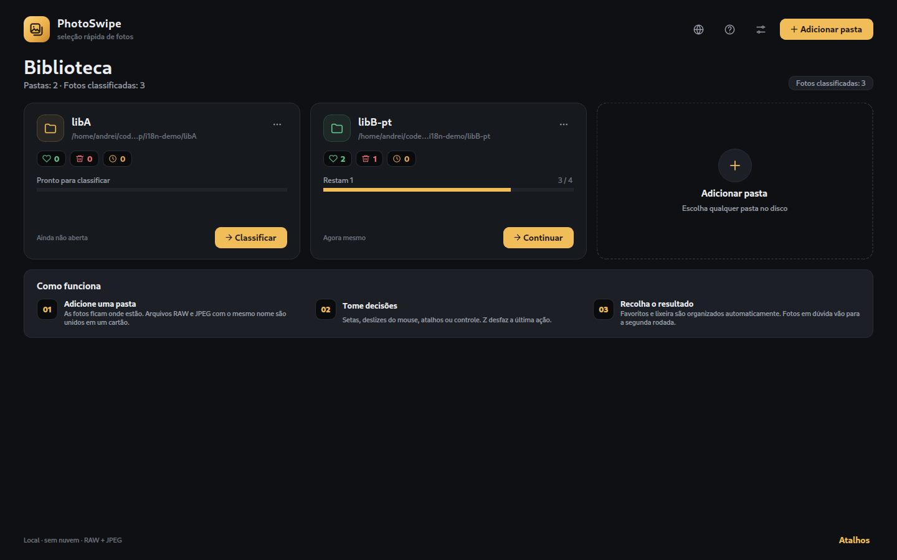
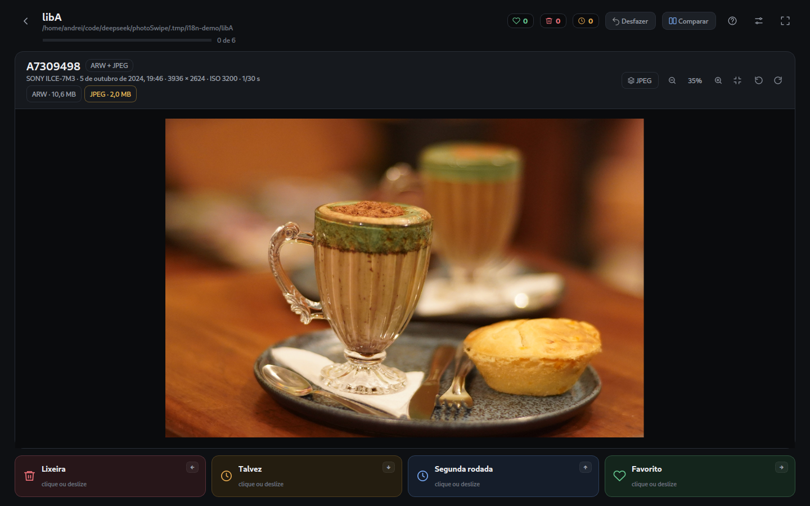
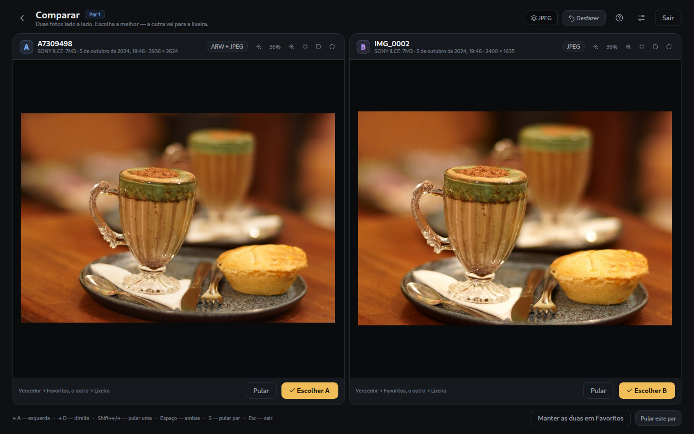
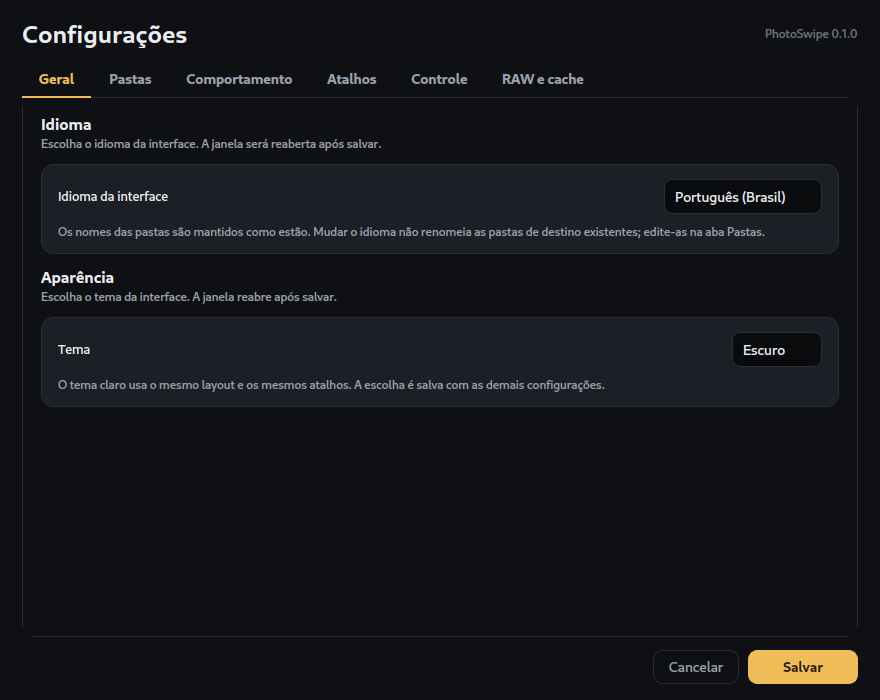

# PhotoSwipe

[English](README.md) · [Русский](README.ru.md) · [**Português (Brasil)**](README.pt.md)

Um **aplicativo de desktop** rápido para selecionar fotos: percorra uma pasta, mantenha os melhores cliques e organize o restante em pastas. Arquivos RAW e JPEG com o mesmo nome são tratados como uma única foto. Tudo roda localmente — sem nuvem e sem uploads.



<p align="center">
  
  
</p>

## Por que Python + PySide6

- O mesmo código roda no **Windows 10/11** e no **Linux**. O Qt também funciona no macOS, mas os alvos principais são Windows/Linux.
- O núcleo (varredura, pareamento RAW+JPEG, movimentação de arquivos, histórico de desfazer) não importa Qt. A interface pode ser substituída sem reescrever a lógica de classificação.
- PySide6 é o binding oficial do Qt. Existe um caminho para **Android** com `pyside6-android-deploy`; veja a seção Android abaixo.
- O RAW é decodificado com **rawpy / LibRaw** (incluído no wheel), sem precisar instalar dcraw ou exiftool separadamente.

## Recursos

- **Idiomas da interface:** inglês, russo e português (Brasil). Escolha em **Configurações → Geral** ou pelo botão de globo no cabeçalho da Biblioteca.
- **Modo portátil no Windows:** mantenha configurações, sessões e cache ao lado do executável em um pendrive.
- Revisão em janela cheia com uma interface escura e sem distrações.
- Quatro decisões: **Favorito**, **Lixeira**, **Talvez** e **Segunda rodada**.
- Deslizes com mouse/toque, atalhos totalmente configuráveis e controle (gamepad).
- Zoom com a roda e os botões, arrastar para mover, girar 90° e redefinir a visualização.
- **Modo de comparação:** duas fotos lado a lado; a vencedora vai para Favoritos e a outra para a Lixeira. Também é possível manter as duas ou adiar o par.
- RAW + JPEG (e outros formatos) com o mesmo nome formam um único cartão. Alterne os formatos para visualizar; a decisão vale para o grupo inteiro.
- Sony ARW/SRF/SR2, Adobe DNG, Canon CR2/CR3, Nikon NEF/NRW, Fujifilm RAF, Olympus ORF, Panasonic RW2 e outros formatos LibRaw.
- Desfaça ações recentes, inclusive depois de reiniciar o aplicativo.
- Movimentação segura, sem sobrescrever: nomes em conflito recebem sufixo ` (1)`, ` (2)`.
- Pastas de destino configuráveis: ao lado de cada pasta de origem ou em uma raiz compartilhada.
- Segunda rodada: as fotos adiadas ficam no lugar e aparecem em uma fila separada.
- Sidecars (`.xmp`, `.aae`, `.pp3`, `.dop`, `.on1`, `.cos`) viajam junto com a foto.

## Instalação

Requer **Python 3.10+** (testado no 3.12).

### Linux

```bash
sudo apt install python3-venv libxcb-cursor0 libxkbcommon-x11-0  # geralmente já instalados
python3 -m venv .venv
source .venv/bin/activate
pip install .
photoswipe
```

Se aparecer `Could not load the Qt platform plugin "xcb"`, instale as bibliotecas XCB indicadas no erro do Qt e tente novamente.

### Windows

```powershell
py -3.12 -m venv .venv
.venv\Scripts\activate
pip install .
photoswipe
```

### Windows portátil / pendrive

1. Compile `PhotoSwipe.exe` no Windows (veja a seção de build autônomo) ou copie uma compilação existente.
2. Coloque o executável em uma pasta própria.
3. Crie um arquivo vazio chamado `portable.flag` ao lado de `PhotoSwipe.exe`. Outra opção é copiar `packaging/portable.bat` para a pasta e iniciar por ele.
4. Abra o aplicativo. Configurações, sessões, histórico de desfazer e cache de prévias ficam em `PhotoSwipeData`, ao lado do executável.

Também é possível iniciar explicitamente:

```powershell
PhotoSwipe.exe --portable
```

A pasta fica autossuficiente — pode ser movida para outro PC ou pendrive junto com `PhotoSwipeData`. Excluir `PhotoSwipeData` redefine o estado e o cache, mas não toca nas suas fotos. A variável `PHOTOSWIPE_DATA_DIR` continua funcionando como override manual.

Depois de compilar no Windows, `packaging/make_portable_windows.ps1` cria a pasta `dist\PhotoSwipePortable` pronta para copiar, com o executável, o marcador e o launcher.

### Executar a partir do código

```bash
python -m photoswipe
```

Para uma instalação portátil:

```bash
PHOTOSWIPE_DATA_DIR=/caminho/para/photo-swipe-data python -m photoswipe
```

`PHOTOSWIPE_CACHE_DIR` pode substituir separadamente o local do cache de prévias.

## Primeira execução

1. Clique em **Adicionar pasta** e escolha um diretório com fotos. A varredura de subpastas pode ser ativada.
2. O PhotoSwipe encontra as imagens e pareia arquivos RAW+JPEG pelo nome.
3. Decida com as setas, botões, deslizes ou um controle.
4. Quando a fila terminar, clique em **Segunda rodada** se houver fotos adiadas.

Por padrão, os resultados ficam ao lado da pasta de origem:

```
Minha pasta/
  _PhotoSwipe/
    Favoritos/
    Lixeira/
    Talvez/
  A7309498.ARW
  A7309498.JPG
```

Em uma instalação nova, os nomes padrão das pastas acompanham o idioma do sistema (por exemplo, `Избранное`, `Корзина`, `Может быть` em russo). Mudar o idioma depois não renomeia as pastas de destino existentes; edite-as nas Configurações.

A segunda rodada não move arquivos: as fotos adiadas permanecem na pasta de origem até a decisão final. É possível alternar entre “ao lado da origem” e uma raiz compartilhada, e adicionar o nome da origem como subpasta.

## Idioma da interface

Abra **Configurações → Geral** ou clique no botão de globo no cabeçalho da Biblioteca. Depois de salvar, a janela reabre no novo idioma.



A interface, os diálogos, as datas, as mensagens de erro, a ajuda dos atalhos e esta documentação estão disponíveis em inglês, russo e português do Brasil. Nomes de arquivos, pastas e valores técnicos de EXIF nunca são traduzidos.

## Atalhos de teclado

| Ação | Padrão |
|---|---|
| Favorito | `→` ou `D` |
| Lixeira | `←` ou `A` |
| Talvez | `↓` ou `S` |
| Segunda rodada | `↑` ou `W` |
| Desfazer | `Z` |
| Comparar | `C` |
| Exibição RAW: JPEG → prévia → completo | `T` |
| Aproximar / afastar | `+` / `−` |
| Girar à direita / à esquerda | `R` / `Shift + R` |
| Redefinir visualização | `0` |
| Tela cheia | `F` |
| Ajuda | `?` ou `F1` |
| Voltar à biblioteca | `Esc` |
| Sair | `Ctrl + Q` |

As setas funcionam em qualquer layout, inclusive no russo. Todas as combinações podem ser alteradas em **Configurações → Atalhos**; até quatro variantes por ação. Conflitos são verificados no momento da atribuição.

### Deslizes

Quando a foto está ajustada à janela:

- esquerda — para a Lixeira;
- direita — para Favoritos;
- cima — segunda rodada;
- baixo — Talvez.

Se você aproximar, arrastar move a imagem em vez de tomar uma decisão. O duplo clique alterna entre ajustar à janela e escala 1:1 da prévia. A roda do mouse aproxima ao redor do cursor.

## Controle (gamepad)

Controles compatíveis com SDL2 são suportados (Xbox, DualShock/DualSense, 8BitDo e a maioria dos gamepads padrão). Conecte o controle antes de iniciar o aplicativo.

| Botão | Ação |
|---|---|
| A / D-pad → | Favorito |
| B / D-pad ← | Lixeira |
| Y / D-pad ↓ | Talvez |
| X / D-pad ↑ | Segunda rodada |
| Back / Select | Desfazer |
| Start / Options | Comparar |
| LB / RB | Girar à esquerda / direita |
| LT / RT | Afastar / aproximar |
| Analógico esquerdo | Mover uma foto ampliada |

No modo de comparação: D-pad ← ou LB escolhe a foto da esquerda, D-pad → ou RB a da direita, A mantém as duas, B sai, Back desfaz.

Altere o mapeamento em **Configurações → Controle**. A zona morta do analógico e a vibração também são configuradas ali. Se o pygame não estiver disponível ou nenhum controle estiver conectado, o aplicativo continua funcionando normalmente.

## Comparação

Clique em **Comparar** ou pressione `C`. O PhotoSwipe pega as duas primeiras fotos da fila e as mostra lado a lado.

- `←` / `A` — a foto da esquerda vence;
- `→` / `D` — a foto da direita vence;
- `Shift + ←` / `Shift + →` — pula apenas essa foto, adia para a segunda rodada e coloca a próxima da fila no lugar;
- `Espaço` — manter as duas em Favoritos;
- `S` — adiar o par para a segunda rodada;
- `Esc` / `C` — sair.

A vencedora vai para Favoritos e a outra para a Lixeira. Isso é um único passo de desfazer. O próximo par abre automaticamente enquanto houver pelo menos duas fotos. O pulo de apenas uma foto também é um único passo de desfazer e fica disponível na primeira passagem; na segunda rodada as duas fotos precisam de uma decisão final.

## RAW e JPEG

Arquivos com o mesmo nome e extensões diferentes na mesma pasta (`A7309498.ARW` + `A7309498.JPG`) formam um único cartão. Os chips de formato no cabeçalho alternam a prévia, mas as decisões valem para o grupo inteiro e seus sidecars.

A exibição RAW pode ser alternada com o botão **Exibição RAW** no visualizador ou com `T`. Os modos se alternam entre:

1. **JPEG do par RAW+JPEG** — mais rápido; usa a prévia RAW embutida quando não há JPEG.
2. **Prévia RAW** — sempre usa a miniatura embutida da câmera.
3. **RAW completo** — revela pelo LibRaw para obter o máximo de detalhes, bem mais lento.

A mesma opção está em **Configurações → RAW → Exibição RAW** e também é usada na comparação. Limpe o cache em **Configurações → RAW e cache**.

Os formatos suportados incluem:

- RAW: Sony ARW/SRF/SR2, Adobe DNG, Canon CR2/CR3, Nikon NEF/NRW, Fujifilm RAF, Olympus ORF, Panasonic RW2, Pentax PEF, Samsung SRW, Hasselblad 3FR, Leica RWL e outros formatos LibRaw;
- imagens: JPEG, PNG, TIFF, WebP, BMP, GIF, AVIF, HEIC/HEIF (via pillow-heif).

## Desfazer e segurança

- Os arquivos são movidos, não copiados: eles não permanecem na pasta de origem.
- Arquivos existentes nunca são sobrescritos; nomes em conflito recebem um sufixo.
- Antes de mover, o PhotoSwipe confirma que todos os arquivos do grupo estão presentes; em caso de falha, reverte os arquivos já movidos.
- A **profundidade do desfazer** é configurável em **Configurações → Comportamento** (1 a 1000 etapas, padrão **120**). Cada etapa armazena caminhos, metadados do grupo e operações de movimentação, não cópias das fotos. Um histórico maior aumenta o JSON da sessão e deixa salvar/abrir um pouco mais lento, mas permite desfazer mais longe após reiniciar. Um histórico menor economiza disco e mantém as gravações mais leves, mas reduz a profundidade. Ao atingir o limite, as etapas mais antigas são descartadas.
- Se um arquivo foi movido ou excluído fora do aplicativo, o desfazer informa o problema em vez de adivinhar.
- A **Lixeira** é uma pasta normal, não a lixeira do sistema. Isso mantém o desfazer previsível.
- **Redefinir progresso** limpa contadores e o histórico de desfazer dessa pasta, mas não restaura nem exclui arquivos já organizados.

## Onde os dados ficam

Configurações, sessões e o cache de prévias ficam na pasta do sistema:

- Linux: `~/.local/share/PhotoSwipe` e `~/.cache/PhotoSwipe`;
- Windows: `%LOCALAPPDATA%\PhotoSwipe`.

O caminho exato aparece em **Configurações → RAW e cache**. Use `PHOTOSWIPE_DATA_DIR` para uma instalação portátil.

## Arquitetura

```
photoswipe/
  config.py          configurações, origens, pastas de destino
  models.py          grupos de fotos, variantes, metadados
  scanner.py         varredura, pareamento RAW+JPEG, EXIF
  media.py           prévias JPEG/RAW e cache
  session.py         decisões, movimentação, segunda rodada, desfazer
  i18n.py            seleção de idioma e auxiliares
  locales/           catálogos russo e português baseados no inglês
  controller.py      controle via SDL2
  shortcuts.py       combinações de teclado
  ui/                interface PySide6
```

O núcleo (`config`, `models`, `scanner`, `media`, `session`, `i18n`) não importa Qt. Isso é intencional: a interface pode ser substituída para Android ou outra plataforma, mantendo a lógica de classificação.

## Android no futuro

Esta stack pode ser portada, mas é um trabalho separado:

- o PySide6 pode ser implantado no Android com `pyside6-android-deploy`;
- os diálogos nativos precisam ser substituídos pelo Storage Access Framework e pelas permissões do Android;
- `rawpy` é uma extensão CPython em torno do LibRaw e exige um wheel para a ABI do Android ou uma camada de prévias embutidas;
- o controle e os deslizes por toque precisam de adaptação;
- o núcleo de varredura/movimentação e os modelos já são independentes da interface.

## Desenvolvimento

```bash
python3 -m venv .venv
source .venv/bin/activate
pip install -e ".[dev]"
python -m unittest discover -s tests -t . -v
python -m photoswipe
```

Os testes usam os arquivos reais `A7309498.ARW` e `A7309498.JPG` na raiz do repositório: agrupamento, metadados, modos de exibição RAW, prévias, movimentação, sidecars, pulo de uma foto na comparação, limite de desfazer, segunda rodada, desfazer, troca de idioma, caminhos portáteis e inicialização da interface. A suíte tem 39 testes.

### Build autônomo

```bash
pip install pyinstaller
pyinstaller PhotoSwipe.spec
```

O resultado aparece em `dist/`. Compile no Windows para obter um executável do Windows (o PyInstaller não faz compilação cruzada). Os ícones estão em `assets/`.

Atalho de desktop no Linux:

```bash
pipx install .
./packaging/install-desktop.sh
```

## Limitações

- O pareamento RAW+JPEG funciona dentro da mesma pasta. Se RAW e JPEG estiverem em subpastas diferentes, serão cartões separados.
- Arquivos RAW sem prévia embutida são decodificados pelo LibRaw; a primeira prévia de um lote grande pode demorar.
- A comparação usa as duas primeiras fotos da fila atual; não há seleção arbitrária de par. Pular uma das partes coloca a próxima foto da fila no lugar.
- Mover para outro disco pode demorar — o aplicativo aguarda a operação terminar para não perder arquivos.
- Ainda não há classificações por estrelas, etiquetas coloridas ou busca por metadados — apenas a seleção.

## Licença

MIT. Veja [LICENSE](LICENSE).
