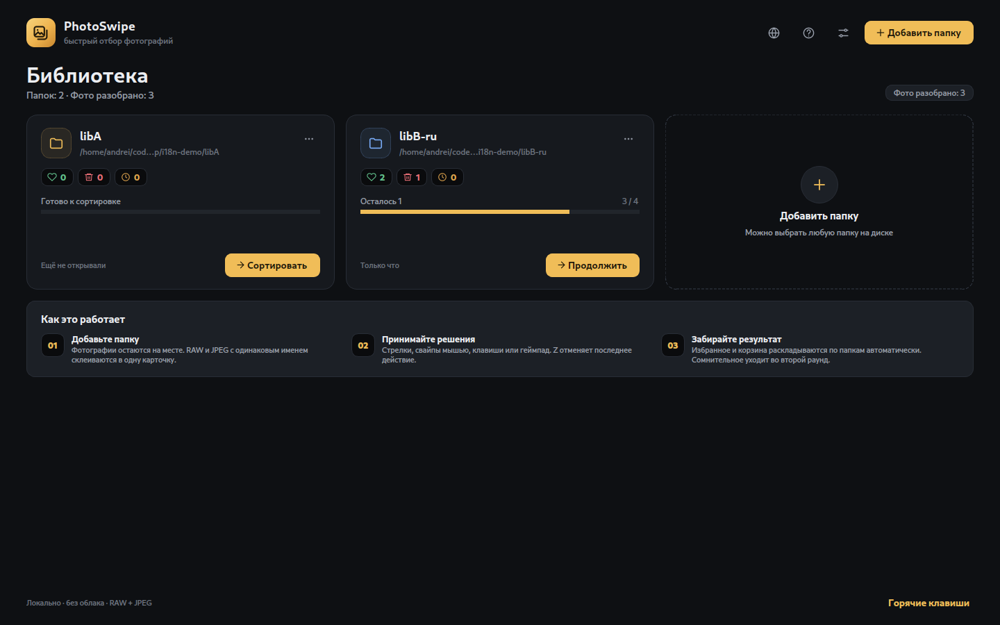
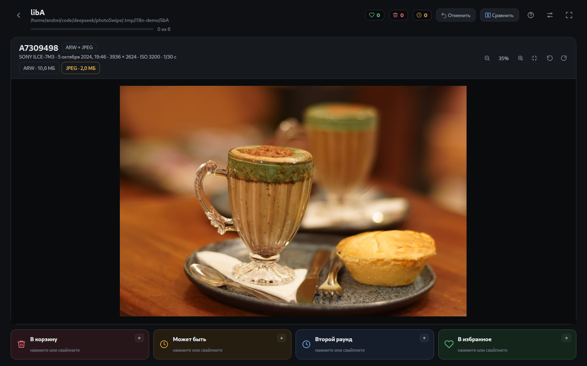
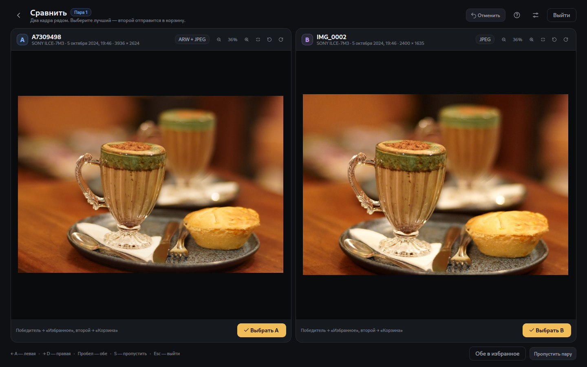
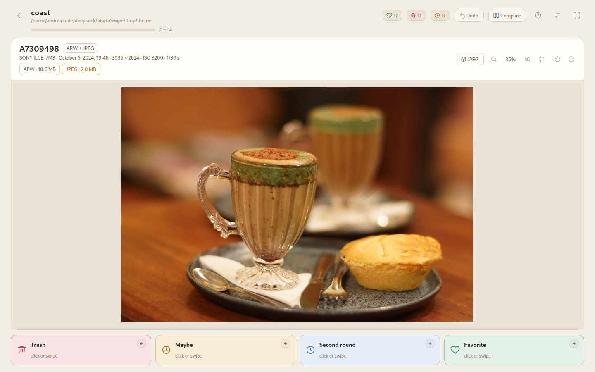

# PhotoSwipe

[English](README.md) · **Русский** · [Português (Brasil)](README.pt.md)

Быстрый **десктопный** сортировщик фотографий: пролистайте папку, оставьте лучшие кадры и разложите остальные по папкам. RAW и JPEG с одинаковым именем обрабатываются как одна фотография. Всё работает локально, без облака и загрузки на сервер.



<p align="center">
  
  
</p>

## Почему Python + PySide6

- Один и тот же код работает на **Windows 10/11** и **Linux**; Qt также работает на macOS, но основные целевые платформы — Windows/Linux.
- Ядро (сканирование, группировка RAW+JPEG, перемещение файлов, история отмены) не зависит от Qt. UI можно заменить, не переписывая логику.
- PySide6 — официальные Qt-биндинги; есть путь развёртывания на **Android** (`pyside6-android-deploy`). Подробнее в разделе «Android» ниже.
- RAW читается через **rawpy / LibRaw** (встроено в wheel), поэтому не нужно отдельно устанавливать dcraw или exiftool.

## Возможности

- Интерфейс на **русском, английском и португальском (Бразилия)**. Язык выбирается в **Настройки → Общие** или кнопкой-глобусом в библиотеке.
- **Тёмная и светлая темы:** выбор в **Настройки → Общие → Внешний вид**.
- **Полноэкранный режим без интерфейса:** скрывает всё, кроме кнопки выхода; все горячие клавиши и геймпад продолжают работать.
- **Портативный режим Windows:** настройки, сессии и кэш можно держать рядом с `.exe` на USB-флешке.
- Просмотр папки с фотографиями в полноэкранном режиме с тёмным интерфейсом.
- Четыре решения: **В избранное**, **В корзину**, **Может быть**, **На второй раунд**.
- Свайпы мышью/пальцем, настраиваемые горячие клавиши, управление геймпадом.
- Зум колесом и кнопками, перетаскивание, поворот на 90°, сброс вида.
- **Режим сравнения**: две фотографии рядом, победитель — в избранное, второй кадр — в корзину. Можно оставить обе или отложить пару.
- RAW + JPEG (и другие форматы) с одинаковым именем — один кадр в интерфейсе; переключение между форматами для просмотра.
- Sony ARW/SRF/SR2, Adobe DNG, Canon CR2/CR3, Nikon NEF/NRW, Fujifilm RAF, Olympus ORF, Panasonic RW2 и другие форматы LibRaw.
- Отмена последних действий, в том числе после перезапуска приложения.
- Безопасное перемещение без перезаписи: при совпадении имён добавляется ` (1)`, ` (2)`.
- Настраиваемые папки назначения: рядом с источником или в общей папке.
- Второй раунд: отложенные фотографии остаются на месте и показываются отдельно.
- Sidecar-файлы (`.xmp`, `.aae`, `.pp3`, `.dop`, `.on1`, `.cos`) переезжают вместе с фотографией.

## Установка

Нужен **Python 3.10+** (проверено на 3.12).

### Linux

```bash
sudo apt install python3-venv libxcb-cursor0 libxkbcommon-x11-0  # обычно уже есть
python3 -m venv .venv
source .venv/bin/activate
pip install .
photoswipe
```

Если при запуске появляется ошибка `Could not load the Qt platform plugin "xcb"`, установите системные библиотеки XCB из сообщения Qt и повторите запуск.

### Windows

```powershell
py -3.12 -m venv .venv
.venv\Scripts\activate
pip install .
photoswipe
```

### Портативная версия для Windows / USB

1. Соберите `PhotoSwipe.exe` на Windows (см. раздел про автономную сборку) или возьмите готовую сборку.
2. Положите `.exe` в отдельную папку.
3. Создайте рядом с `PhotoSwipe.exe` пустой файл `portable.flag`. Либо скопируйте туда `packaging/portable.bat` и запускайте его.
4. Запустите приложение. Настройки, сессии, история отмены и кэш превью будут лежать в папке `PhotoSwipeData` рядом с `.exe`.

Можно запустить и явно:

```powershell
PhotoSwipe.exe --portable
```

Папка становится самодостаточной: её можно перенести на другой компьютер или флешку вместе с `PhotoSwipeData`. Удаление `PhotoSwipeData` сбрасывает состояние и кэш, но не трогает фотографии. Переменная `PHOTOSWIPE_DATA_DIR` по-прежнему работает как ручной override.

После сборки на Windows скрипт `packaging/make_portable_windows.ps1` создаёт готовую к копированию папку `dist\PhotoSwipePortable` с `.exe`, маркером данных и ярлыком запуска.

### Steam Deck / AppImage

Собирайте AppImage на **x86_64 Linux** (SteamOS умеет запускать AppImage, но для сборки удобнее обычный Linux или контейнер). Нужны виртуальное окружение проекта с PyInstaller, `curl` и `mksquashfs`; если `appimagetool` нет в `PATH`, скрипт скачает его в `build/tools`.

```bash
./packaging/build_appimage.sh
```

Результат:

```text
dist/PhotoSwipe-x86_64.AppImage
```

#### Установка на Steam Deck

1. Переключите Deck в **режим рабочего стола**.
2. Скопируйте AppImage в домашнюю папку, например `~/Applications/`.
3. Сделайте файл исполняемым и запустите:

```bash
mkdir -p ~/Applications
cp PhotoSwipe-x86_64.AppImage ~/Applications/
chmod +x ~/Applications/PhotoSwipe-x86_64.AppImage
~/Applications/PhotoSwipe-x86_64.AppImage
```

Если AppImage сообщает об отсутствии FUSE/libfuse2, запустите его в режиме извлечения:

```bash
APPIMAGE_EXTRACT_AND_RUN=1 ~/Applications/PhotoSwipe-x86_64.AppImage
```

#### Добавление в Steam

1. В режиме рабочего стола откройте Steam → **Игры → Добавить стороннюю игру → Обзор**.
2. Выберите `~/Applications/PhotoSwipe-x86_64.AppImage`.
3. В **Свойства → Совместимость** не включайте Proton — это нативное Linux-приложение.
4. Если FUSE недоступен, задайте **Параметры запуска**:

```text
APPIMAGE_EXTRACT_AND_RUN=1 %command%
```

5. Чтобы сразу открыть папку, добавьте путь после команды:

```text
%command% "/home/deck/Pictures"
```

6. Переключитесь в игровой режим и запустите PhotoSwipe из библиотеки.

Геймпад работает через встроенную поддержку контроллеров. Горячие клавиши доступны только с физической клавиатурой; для первичной настройки папок удобнее режим рабочего стола.

### Открытие папки из файлового менеджера

PhotoSwipe принимает папку аргументом командной строки, добавляет её в библиотеку и сразу открывает:

```text
PhotoSwipe.exe "D:\Фото\2026-05"
photoswipe /home/me/Pictures/2026-05
```

Именно это используется пунктом **Открыть с помощью PhotoSwipe** в Проводнике, Nautilus, Dolphin и других файловых менеджерах.

#### Контекстное меню Windows

1. Возьмите собранный `PhotoSwipe.exe` и скопируйте путь к нему.
2. Откройте [packaging/windows-open-with-photoswipe.reg](packaging/windows-open-with-photoswipe.reg), замените все `C:\\Path\\To\\PhotoSwipe.exe` на реальный путь и сохраните файл. В `.reg` обратные слэши удваиваются — это синтаксис реестра.
3. Дважды щёлкните `.reg` и подтвердите импорт.
4. Щёлкните папку правой кнопкой → **Открыть с помощью PhotoSwipe**. Пункт также доступен на пустом месте внутри папки.

Файл добавляет ключи только для текущего пользователя (права администратора не нужны):

```text
HKEY_CURRENT_USER\Software\Classes\Directory\shell\PhotoSwipe\command
HKEY_CURRENT_USER\Software\Classes\Directory\Background\shell\PhotoSwipe\command
```

Для папки используется `%1`, для фона папки — `%V`. В Windows 11 пункт может находиться в **Показать дополнительные параметры**.

Чтобы удалить пункт, удалите ключи `PhotoSwipe` в `HKEY_CURRENT_USER\Software\Classes\Directory\shell` и `...\Directory\Background\shell`.

Если приложение запускается из Python-окружения, а не из `.exe`, укажите `pythonw.exe` этого окружения с `-m photoswipe "%1"`, например:

```text
"C:\Projects\photoSwipe\.venv\Scripts\pythonw.exe" -m photoswipe "%1"
```

#### Файловый менеджер Linux

1. Скопируйте [packaging/photoswipe.desktop](packaging/photoswipe.desktop) в `~/.local/share/applications/photoswipe.desktop`.
2. Укажите в `Exec` реальную команду, например `Exec=/opt/PhotoSwipe/PhotoSwipe %f` или `Exec=/home/me/photoSwipe/.venv/bin/photoswipe %f`, а в `Icon` — путь к иконке.
3. Выполните:

```bash
update-desktop-database ~/.local/share/applications
```

4. Щёлкните папку правой кнопкой → **Открыть с помощью** → **PhotoSwipe**. В некоторых менеджерах пункт называется **Другое приложение**.

Если файловый менеджер не показывает приложения для папок, используйте необязательный скрипт Nautilus:

```bash
mkdir -p ~/.local/share/nautilus/scripts
cp packaging/nautilus-open-with-photoswipe.sh \
  ~/.local/share/nautilus/scripts/"Open with PhotoSwipe"
chmod +x ~/.local/share/nautilus/scripts/"Open with PhotoSwipe"
```

Измените строку `exec` в скопированном скрипте на путь к PhotoSwipe. Скрипт появится в контекстном меню **Скрипты**.

### Запуск из исходников

```bash
python -m photoswipe
```

Полезно для переносимой установки:

```bash
PHOTOSWIPE_DATA_DIR=/path/to/photo-swipe-data python -m photoswipe
```

`PHOTOSWIPE_CACHE_DIR` отдельно задаёт папку кэша превью.

## Первый запуск

1. Нажмите **«Добавить папку»** и выберите каталог с фотографиями. Можно включить сканирование подпапок.
2. PhotoSwipe найдёт изображения и соберёт пары RAW+JPEG по имени файла.
3. Принимайте решения стрелками, кнопками, свайпами или геймпадом.
4. Когда очередь закончится, нажмите **«Второй раунд»**, если есть отложенные кадры.

По умолчанию результаты лежат рядом с исходной папкой:

```
Моя папка/
  _PhotoSwipe/
    Избранное/
    Корзина/
    Может быть/
  A7309498.ARW
  A7309498.JPG
```

«Второй раунд» ничего не перемещает: отложенные фотографии остаются в исходной папке, пока вы не примете окончательное решение. Папку и имена можно изменить в настройках: рядом с источником или в общей папке, с добавлением имени источника.

## Горячие клавиши

| Действие | По умолчанию |
|---|---|
| В избранное | `→` или `D` |
| В корзину | `←` или `A` |
| Может быть | `↓` или `S` |
| Второй раунд | `↑` или `W` |
| Отменить | `Z` |
| Сравнить | `C` |
| Отображение RAW: JPEG → thumbnail → полный | `T` |
| Увеличить / уменьшить | `+` / `−` |
| Повернуть вправо / влево | `R` / `Shift + R` |
| Сбросить вид | `0` |
| Полный экран без интерфейса | `F` |
| Справка | `?` или `F1` |
| К библиотеке | `Esc` |
| Выход | `Ctrl + Q` |

Стрелки работают и в русской раскладке. Все комбинации меняются в **Настройки → Клавиши**; на действие можно назначить до четырёх вариантов. Конфликты комбинаций проверяются при назначении.

### Полноэкранный режим без интерфейса

Нажмите `F` в режиме сортировки или сравнения. PhotoSwipe скроет шапку, панель действий, элементы сравнения и весь остальной интерфейс. Останутся только фотографии и небольшая кнопка **Выйти из полноэкранного режима** в правом верхнем углу.

- Все горячие клавиши продолжают работать: решения, отмена, выбор в сравнении, пропуск одной стороны, отображение RAW, зум, поворот и кнопки геймпада.
- `Esc` или `F` выходят из полноэкранного режима.
- Когда очередь или сравнение заканчиваются, приложение автоматически выходит из полноэкранного режима и показывает экран завершения.
- Обычные уведомления в этом режиме скрываются; ошибки по-прежнему показываются.

### Язык интерфейса

Язык переключается в **Настройки → Общие** или кнопкой-глобусом в правом верхнем углу библиотеки. После сохранения окно переоткрывается с новым языком. Уже сохранённые имена папок назначения не переименовываются: их можно изменить на вкладке «Папки». Для новой установки имена папок по умолчанию создаются на выбранном языке системы.

### Тема

Выберите **Настройки → Общие → Внешний вид → Тема**: **Тёмная** или **Светлая**. Настройка сохраняется, и окно открывается заново с новой палитрой. Обе темы используют одинаковую раскладку, горячие клавиши и папки назначения.



### Свайпы

Когда фотография вписана в окно:

- влево — в корзину;
- вправо — в избранное;
- вверх — на второй раунд;
- вниз — в «Может быть».

Если кадр приближен, перетаскивание двигает изображение, а не принимает решение. Двойной щелчок переключает «вписать в окно» / масштаб 1:1. Колесо мыши приближает точку под курсором.

## Геймпад

Поддерживаются контроллеры, которые видит SDL2 (Xbox, DualShock/DualSense, 8BitDo и большинство стандартных контроллеров). Подключите контроллер до запуска приложения.

| Кнопка | Действие |
|---|---|
| A / D-pad → | В избранное |
| B / D-pad ← | В корзину |
| Y / D-pad ↓ | Может быть |
| X / D-pad ↑ | Второй раунд |
| Back / Select | Отменить |
| Start / Options | Сравнение |
| LB / RB | Повернуть влево / вправо |
| LT / RT | Уменьшить / увеличить |
| Левый стик | Двигать приближенный кадр |

В сравнении: D-pad ← или LB — выбрать левый кадр, D-pad → или RB — правый, A — оставить оба, B — выйти, Back — отменить.

Раскладку можно изменить в **Настройки → Контроллер**. Мёртвая зона стика и виброотклик настраиваются там же. Если pygame не установлен или контроллер не найден, приложение продолжает работать без него.

## Сравнение

Нажмите **«Сравнить»** или `C`. PhotoSwipe берёт первые две фотографии очереди и показывает их рядом.

- `←` / `A` — левая лучше;
- `→` / `D` — правая лучше;
- `Shift + ←` / `Shift + →` — пропустить только это фото, отложить его на второй раунд и поставить на его место следующее из очереди;
- `Пробел` — обе в избранное;
- `S` — отложить пару на второй раунд;
- `Esc` / `C` — выйти.

Победитель перемещается в «Избранное», второй кадр — в «Корзину». Это одна операция отмены. После решения автоматически открывается следующая пара, пока в очереди есть хотя бы две фотографии. Пропуск одного фото также отменяется одной операцией и доступен только в первом раунде; во втором раунде оба кадра должны получить окончательное решение.

## RAW и JPEG

Файлы с одинаковым именем и разными расширениями в одной папке (`A7309498.ARW` + `A7309498.JPG`) считаются одной карточкой. Кнопки форматов в шапке переключают просмотр, но решение применяется ко всей группе и её sidecar-файлам.

Отображение RAW переключается кнопкой **RAW display** в просмотрщике или клавишей `T`. Режимы идут по кругу:

1. **JPEG из пары RAW+JPEG** — быстрее всего; если JPEG нет, используется встроенное RAW-превью.
2. **RAW thumbnail** — всегда встроенное превью камеры.
3. **Полный RAW** — демозаика через LibRaw для максимальной детализации, заметно медленнее.

Тот же выбор есть в **Настройки → RAW → Отображение RAW**; он применяется и в режиме сравнения. Очистить кэш можно в **Настройки → RAW и кэш**.

Поддерживаются, в частности:

- RAW: Sony ARW/SRF/SR2, Adobe DNG, Canon CR2/CR3, Nikon NEF/NRW, Fujifilm RAF, Olympus ORF, Panasonic RW2, Pentax PEF, Samsung SRW, Hasselblad 3FR, Leica RWL и другие форматы LibRaw;
- изображения: JPEG, PNG, TIFF, WebP, BMP, GIF, AVIF, HEIC/HEIF (через pillow-heif).

## Отмена и безопасность

- Перемещение, а не копирование: файл не остаётся в исходной папке.
- Существующие файлы никогда не перезаписываются; при конфликте добавляется суффикс.
- Перед перемещением проверяется, что все файлы группы на месте; при сбое выполняется откат уже перемещённых файлов.
- Глубина отмены настраивается в **Настройки → Поведение** (от 1 до 1000 шагов, по умолчанию **120**). Каждый шаг хранит пути к файлам, метаданные группы и операции перемещения, а не копии фотографий. Большая история увеличивает JSON сессии и немного замедляет сохранение/открытие, но позволяет отменять действия глубже после перезапуска. Маленькая история экономит место и ускоряет запись, но уменьшает глубину отмены. При достижении предела самые старые шаги удаляются.
- Если файл переместили или удалили вне приложения, отмена сообщит об ошибке, не пытаясь угадать.
- «Корзина» — это обычная папка, а не системная корзина. Так отмена остаётся предсказуемой.
- «Сбросить прогресс» очищает счётчики и историю, но не возвращает и не удаляет уже разложенные файлы.

## Где хранятся данные

Настройки, сессии и кэш лежат в системной папке приложения:

- Linux: `~/.local/share/PhotoSwipe` и `~/.cache/PhotoSwipe`;
- Windows: `%LOCALAPPDATA%\PhotoSwipe`.

Точный путь виден в **Настройки → RAW и кэш**. Каталог можно переопределить переменной `PHOTOSWIPE_DATA_DIR` (удобно для портативной установки).

## Архитектура

```
photoswipe/
  config.py          настройки, источники, папки назначения
  models.py          модели групп, вариантов, метаданных
  scanner.py         сканирование, группировка RAW+JPEG, EXIF
  media.py           превью JPEG/RAW и кэш
  session.py         решения, перемещение, второй раунд, undo
  controller.py      геймпад через SDL2
  shortcuts.py       комбинации клавиш
  ui/                PySide6-интерфейс
```

Ядро (`config`, `models`, `scanner`, `media`, `session`) не импортирует Qt. Это сделано специально для будущего порта: интерфейс можно заменить на Qt for Android или другой UI, сохранив логику сортировки.

## Android в будущем

Выбранный стек допускает порт, но это отдельная работа:

- PySide6 можно развернуть на Android через `pyside6-android-deploy`;
- вместо нативных диалогов понадобится Storage Access Framework и разрешения Android;
- `rawpy` — CPython-расширение с LibRaw, для Android потребуется собрать wheel под нужную ABI или использовать встроенные превью через отдельный слой;
- управление геймпадом и свайпы на touch нужно будет адаптировать;
- ядро сканирования/перемещения и модели уже отделены от UI.

## Разработка

```bash
python3 -m venv .venv
source .venv/bin/activate
pip install -e ".[dev]"
python -m unittest discover -s tests -t . -v
python -m photoswipe
```

В тестах используются реальные файлы `A7309498.ARW` и `A7309498.JPG`, лежащие в корне репозитория: проверяются группировка, метаданные, режимы отображения RAW, превью, перемещение, sidecar-файлы, пропуск одной фотографии в сравнении, лимит undo, второй раунд, undo, переключение языка, портативные пути и запуск интерфейса. Всего 42 теста.

### Сборка автономного приложения

```bash
pip install pyinstaller
pyinstaller PhotoSwipe.spec
```

Готовый файл появится в `dist/`. На Windows для сборки используйте Windows (PyInstaller не делает кросс-компиляцию). Иконки лежат в `assets/`.

Для Linux можно установить ярлык:

```bash
pipx install .
./packaging/install-desktop.sh
```

## Ограничения

- Группировка RAW+JPEG выполняется в пределах одной папки. Если RAW и JPEG лежат в разных подпапках, они будут разными карточками.
- Для RAW-файлов без встроенного превью используется LibRaw; на очень больших подборках первое создание превью может занять время.
- Сравнение берёт первые две фотографии текущей очереди; произвольный выбор пары не предусмотрен. Пропуск одной стороны подставляет следующую фотографию из очереди.
- Перемещение на другой диск может занять заметное время — приложение ждёт завершения операции, чтобы не терять файлы.
- Нет рейтингов, цветовых меток и поиска по метаданным — только отбор.

## Лицензия

MIT. См. [LICENSE](LICENSE).
